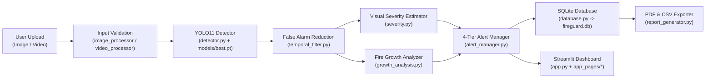
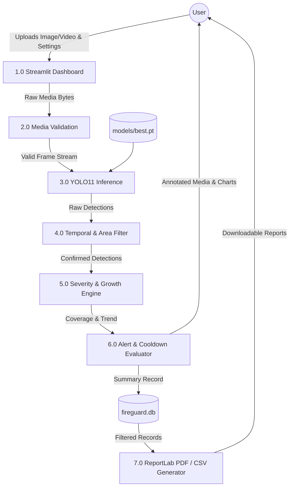
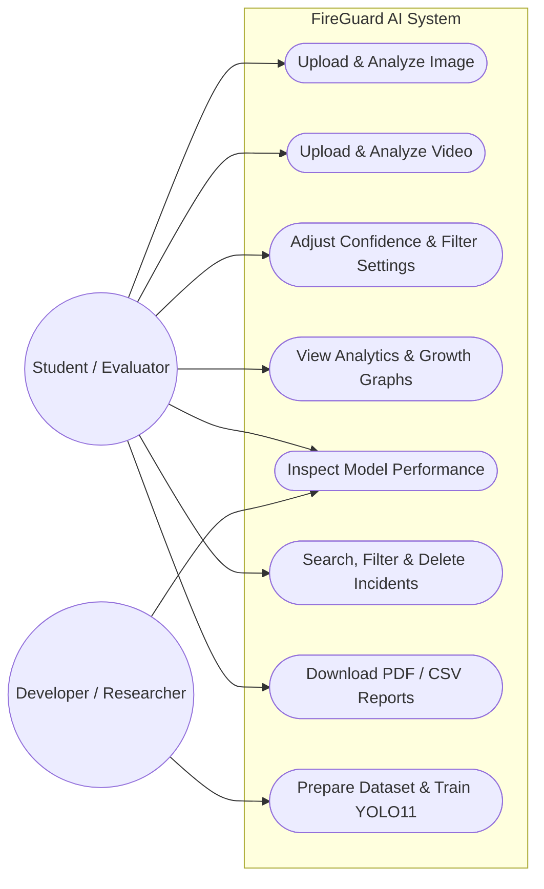
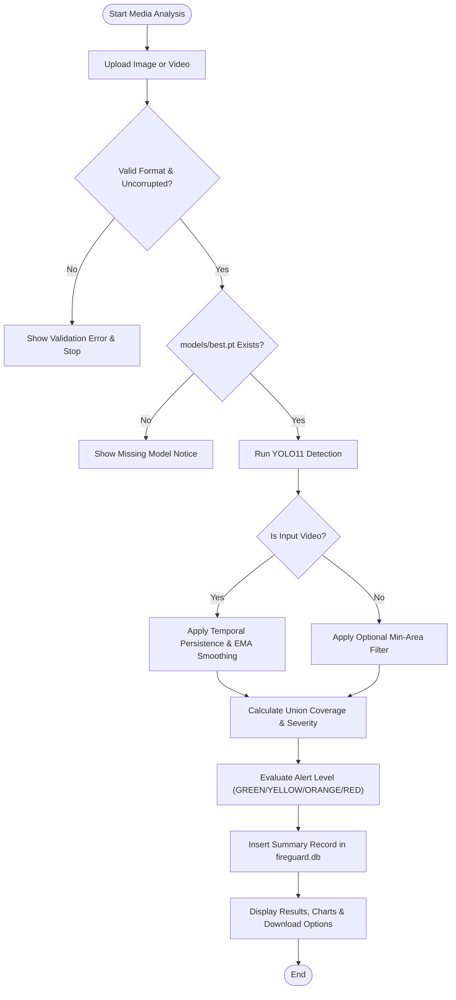
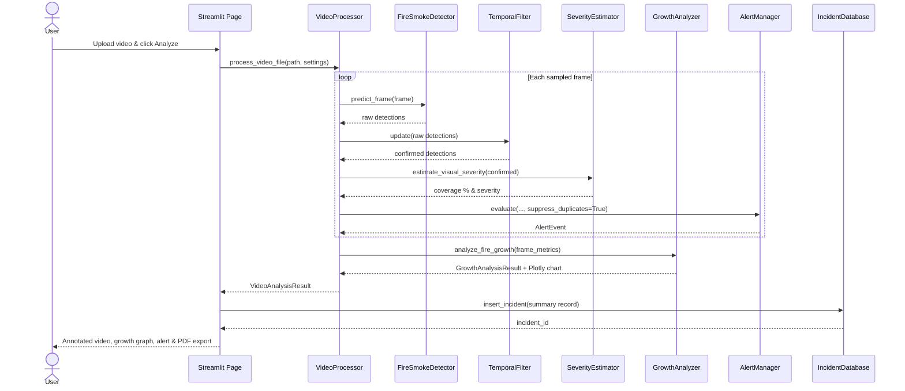
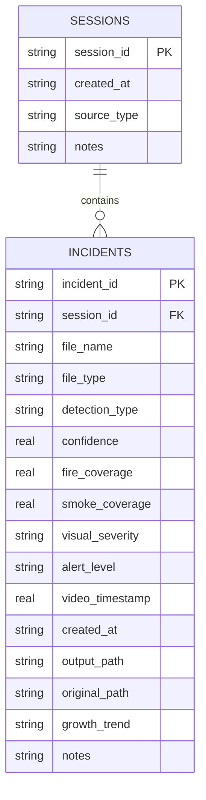

# FireGuard AI — Academic Project Documentation

**Project Title:** FireGuard AI — Intelligent Fire and Smoke Detection with Early Warning and Visual Severity Analysis Using Deep Learning

> **Prototype Disclaimer:** FireGuard AI is a software-only academic research prototype developed for educational demonstration and evaluation. It is not a certified fire detection or life-safety system.

---

## 1. Abstract

Early visual detection of smoke and fire is essential for reducing property loss, ecological damage, and delayed situational awareness. Conventional hardware-only smoke alarms rely on physical particles reaching a ceiling sensor, while naive color-based vision methods suffer from high false-alarm rates caused by sunsets, headlights, artificial lighting, fog, and steam. **FireGuard AI** presents a completely software-based deep learning prototype built with **Ultralytics YOLO11**, **OpenCV**, **SQLite**, **Plotly**, **ReportLab**, and **Streamlit**. The system analyzes uploaded images and prerecorded videos to detect fire and smoke independently or jointly, suppresses transient false positives through calibrated thresholds and multi-frame temporal persistence filtering, estimates approximate 2D visual coverage via exact bounding-box union geometry, classifies temporal fire growth across video frames, triggers 4-tier software alerts (`GREEN`, `YELLOW`, `ORANGE`, `RED`) with cooldown suppression, logs incident records in SQLite (`fireguard.db`), and exports automated PDF and CSV reports.

---

## 2. Introduction

Uncontrolled fires escalate rapidly from smoldering ignition to visible flames. Often, smoke appears well before open flames become visible from a camera vantage point, offering an opportunity for early visual warning. Modern single-stage object detectors such as the **YOLO (You Only Look Once)** family enable localized real-time detection of both smoke plumes and open flames directly from standard RGB imagery without specialized thermal sensors or dedicated IoT hardware.

FireGuard AI integrates deep learning object detection into an end-to-end modular software pipeline designed to run on standard laptops and desktops after GPU-assisted training on Google Colab.

---

## 3. Problem Statement

Existing academic fire-detection demos often suffer from four major limitations:
1. **Flame-only detection:** Ignoring smoke delays early warnings during smoldering stages.
2. **High false-positive rates:** Sunsets, orange walls, headlights, clouds, fog, and steam frequently trigger erroneous warnings when models lack hard-negative training or temporal verification.
3. **Lack of contextual severity or growth insight:** Raw bounding boxes alone do not communicate visual frame coverage, whether smoke preceded flames, or whether the visible hazard is expanding over time.
4. **Fragmented tooling:** Many prototypes consist of standalone scripts without persistent incident logging, downloadable reports, or an interactive monitoring interface.

---

## 4. Existing System

Traditional and baseline approaches fall into two broad categories:
- **Hardware Sensor Systems:** Ionization, photoelectric, or thermal detectors require physical proximity to smoke particles or heat plumes and cannot provide visual verification, spatial localization, or coverage progression over large open areas.
- **Basic Vision / Legacy CNN Approaches:** Classical RGB/HSV color-thresholding heuristics break under changing illumination, reflections, and orange backgrounds. Early image-level CNN classifiers (such as whole-frame classification models) indicate whether fire is present globally in an image but fail to localize multiple regions or measure frame coverage.

---

## 5. Proposed System

FireGuard AI addresses these shortcomings purely through software:
- **Dual-Class Object Detection (YOLO11):** Independently localizes `smoke` and `fire` regions in images and prerecorded videos.
- **Context-Aware False-Alarm Reduction:** Combines negative/hard-negative dataset curation (D-Fire background scenes + FIgLib pre-ignition frames), calibrated confidence thresholds, minimum area constraints, and video temporal persistence + EMA confidence smoothing.
- **Union-Based Visual Severity Estimation:** Computes exact 2D bounding-box union percentages so overlapping detections are never double-counted.
- **Temporal Fire Growth Analysis:** Tracks smoothed coverage across video timestamps, detects smoke lead time prior to flames, and classifies trends (`Increasing`, `Decreasing`, `Relatively stable`, `Insufficient data`).
- **4-Tier Software Alert & Reporting Platform:** Evaluates `GREEN`/`YELLOW`/`ORANGE`/`RED` alerts with duplicate suppression, persists session summaries in SQLite (`fireguard.db`), and renders an interactive 7-page dark-charcoal Streamlit dashboard with ReportLab PDF and CSV export.

---

## 6. Literature Survey

1. **Redmon, J., Divvala, S., Girshick, R., & Farhadi, A. (2016)** introduced *YOLO (You Only Look Once)* in CVPR, unifying bounding-box regression and class probability prediction into a single convolutional pass for fast object detection.
2. **Muhammad, K., Ahmad, J., Mehmood, I., Rho, S., & Baik, S. W. (2018)** demonstrated convolutional neural networks for fire detection in surveillance videos (*IEEE Access*), showing strong accuracy improvements over handcrafted color and motion heuristics while highlighting the importance of avoiding false alarms on fire-like scenes.
3. **de Venâncio, P. V. A. B., Lisboa, A. C., & Barbosa, A. V. (2022)** released the **D-Fire** benchmark dataset and evaluated low-power CNN fire detectors (*Neural Computing and Applications*), incorporating more than 21,000 labeled images spanning fire, smoke, joint fire-smoke, and challenging negative environments.
4. **de Venâncio, P. V. A. B., Campos, R. J., Rezende, T. M., Lisboa, A. C., & Barbosa, A. V. (2023)** extended spatial fire detection with temporal pattern analysis (*Neural Computing and Applications*), reinforcing the value of multi-frame consistency to suppress transient false alarms.
5. **Dewangan, A., Pande, Y., Braun, H.-W., Vernon, F., Perez, I., Altıntaş, I., Cottrell, G. W., & Nguyen, M. H. (2022)** introduced **FIgLib & SmokeyNet** (*Remote Sensing*), providing sequence-based wildfire smoke imagery from HPWREN cameras with pre- and post-ignition timestamps to measure early smoke detection latency.
6. **Jocher, G., & Qiu, J. (2024)** developed **Ultralytics YOLO11**, providing improved feature extraction backbones, anchor-free decoupled detection heads, and fast CPU/GPU inference suitable for lightweight deployment (`YOLO11n`).

---

## 7. Project Objectives

- Detect fire and smoke independently and simultaneously from uploaded images (`.jpg`, `.jpeg`, `.png`, `.webp`) and prerecorded videos (`.mp4`, `.avi`, `.mov`).
- Identify normal and visually deceptive environments (fog, clouds, steam, sunsets, artificial lighting) while explicitly documenting that negative predictions do not prove safety.
- Localize regions with color-coded bounding boxes (Red for fire, Orange for smoke) and prediction confidence scores.
- Estimate approximate 2D visual severity using bounding-box union coverage (`Low`, `Medium`, `High`).
- Analyze temporal coverage trends across video frames and issue early smoke warnings.
- Persist incident history in SQLite and generate downloadable ReportLab PDF and CSV reports via a modern Streamlit dashboard.

---

## 8. Functional Requirements

1. **Dataset Management:** Audit images/labels, remove duplicates, prevent cross-split sequence leakage, and generate `dataset/data.yaml`.
2. **Training & Evaluation:** Train YOLO11 via transfer learning (`training/train.py`, `notebooks/model_training.ipynb`) and evaluate on independent test splits (`training/evaluate.py`).
3. **Image Detection:** Validate image formats/integrity, run inference, adjust confidence threshold, view original vs annotated images, and download output.
4. **Video Detection:** Stream prerecorded videos frame-by-frame, display progress, compute processing FPS, show first-appearance timestamps, render growth charts, and export annotated MP4.
5. **Severity & Filtering:** Compute union coverage %, apply temporal persistence filtering, and suppress duplicate alerts within cooldowns.
6. **Storage & Reporting:** Store summary incidents in `fireguard.db`, filter/search/delete records, export CSV, and generate formatted PDF reports.

---

## 9. Non-Functional Requirements

- **Software-Only Portability:** Runs on standard CPU laptops/desktops with zero hardware or paid API dependencies.
- **Memory Efficiency:** Streams videos frame-by-frame (`cv2.VideoCapture`) instead of loading all frames into RAM.
- **Reliability & Security:** Uses parameterized SQLite queries, explicit input validation, and clean domain error handling without crashing the dashboard.
- **Scientific Integrity:** Displays actual observed evaluation outputs or explicit unavailable statuses; never fabricates accuracy scores or fallback fake detections.

---

## 10. Software Requirements

- **Operating System:** Windows 10/11, Linux (Ubuntu 20.04+), or macOS; Google Colab for GPU training.
- **Python:** Python 3.10–3.13.
- **Core Libraries:** PyTorch (`>=2.2.0`), Ultralytics YOLO11 (`>=8.3.0,<9.0.0`), OpenCV (`>=4.9.0`), NumPy, Pillow, Pandas, Scikit-learn, PyYAML, Matplotlib, Seaborn.
- **Web & Reporting:** Streamlit (`>=1.40.0`), Plotly (`>=5.20.0`), ReportLab (`>=4.1.0`), SQLite3 (Python standard library), Pytest (`>=8.0.0`).

---

## 11. System Architecture

---

## 12. Data Flow Diagram (DFD — Level 1)

---

## 13. Use Case Diagram

---

## 14. Activity Diagram

---

## 15. Sequence Diagram

---

## 16. Database ER Diagram

---

## 17. Dataset Description

- **Primary Dataset (`D-Fire`):** Open dataset compiled by Gaia / de Venâncio et al. (`https://github.com/gaia-solutions-on-demand/DFireDataset`) containing over 21,000 images with YOLO bounding-box annotations for `0: smoke` and `1: fire`, alongside background negative images (normal rooms, forests, sunsets, artificial lighting, clouds, fog) represented by empty `.txt` label files.
- **External Validation Dataset (`FIgLib`):** HPWREN Fire Ignition Library (`https://www.hpwren.ucsd.edu/FIgLib/`), featuring time-series wildfire camera sequences from 40 minutes before to 40 minutes after ignition (`<origin_ts>_<offset>.jpg`).
- **Auditing & Splitting (`training/prepare_dataset.py`):** Corrupt/zero-byte files are dropped, exact SHA-256 and perceptual dHash duplicates are flagged/removed, annotations are validated to `[0, 1]`, and related sequence frames are grouped via `GroupShuffleSplit` into leakage-free 70% train / 20% validation / 10% test splits.

---

## 18. YOLO Algorithm Explanation

YOLO ("You Only Look Once") formulates object detection as a single-pass regression problem. An input image is letterboxed to `640 × 640`, normalized to `[0, 1]`, and passed through a convolutional backbone and multi-scale feature pyramid neck (PAFPN/C3k2 blocks in YOLO11) to decoupled detection heads. Each grid location predicts bounding-box coordinates `(x1, y1, x2, y2)` and independent class probabilities (`fire`, `smoke`), followed by Non-Maximum Suppression (NMS) to remove overlapping duplicate boxes for the same instance.

---

## 19. Model Training Methodology

Transfer learning initializes **YOLO11n** (and optional comparison models **YOLO11s**, **YOLOv8n**) from COCO-pretrained weights, adapting only the detection heads to the 2-class fire/smoke schema specified in `dataset/data.yaml`. Conservative training-only augmentations (horizontal flip, mild brightness/contrast shifts, controlled scaling, mosaic, and mild sensor noise) improve generalization without creating unrealistic flame artifacts. Initial baseline hyperparameters (`epochs=50`, `imgsz=640`, `batch=16`, `optimizer="auto"`, `patience=15`, `seed=42`) include automatic GPU selection, epoch-wise validation, early stopping, and checkpoint selection (`best.pt`).

---

## 20. Proposed False Alarm Reduction Methodology

1. **Hard-Negative Learning:** Negative images (sunsets, lamps, fog, clouds, headlights) teach visual context directly during training.
2. **Threshold & Geometry Filtering:** Calibrated per-class thresholds plus minimum bounding-box area filtering (`min_box_area_ratio`) discard tiny specular glare spots.
3. **Temporal Consistency & EMA Smoothing:** In videos, `TemporalFalseAlarmFilter` requires a detection class to persist across `min_consecutive_frames` or exceed `min_persistence_ratio` within a sliding window before confirmation, while smoothing frame confidence via Exponential Moving Average (EMA).
4. **Trade-Off Transparency:** `training/evaluate.py` reports exact false-positive reduction alongside any missed detections or verification delay (`(min_consecutive_frames - 1) / fps`).

---

## 21. Implementation

Implemented modularly across `config.py`, `training/` (`prepare_dataset.py`, `validate_dataset.py`, `train.py`, `evaluate.py`), `src/` (`detector.py`, `image_processor.py`, `video_processor.py`, `severity.py`, `temporal_filter.py`, `growth_analysis.py`, `alert_manager.py`, `database.py`, `report_generator.py`, `ui_helpers.py`), `app.py`, `app_pages/`, and `assets/styles.css`.

---

## 22. Testing

Comprehensive automated unit and integration tests reside in `tests/test_detection.py`, `tests/test_severity.py`, and `tests/test_database.py`, covering 22 explicit functional and failure-recovery scenarios plus Streamlit `AppTest` verification across all 7 pages. Controlled mock detector outputs are restricted strictly to software unit tests.

---

## 23. Experimental Results

Real training and test metrics are generated dynamically when running `training/train.py` and `training/evaluate.py` on the downloaded D-Fire/FIgLib splits and persisted to `models/training_summary.json` and `models/evaluation_results.json`. Prior to executing actual dataset training, the dashboard's **Model Performance** page explicitly displays an unavailable status rather than fabricated values.

---

## 24. Advantages

- Zero dependency on physical sensors, microcontrollers, CCTV hardware, or paid APIs.
- Early smoke warning capability independent of open flames.
- Reduced transient false alarms via multi-frame persistence verification.
- Exact union-based visual coverage avoids overlapping bounding-box inflation.
- End-to-end persistence (SQLite) and automated PDF/CSV reporting.

---

## 25. Limitations

- Cannot detect concealed fires behind walls or out-of-frame hazards.
- Visual 2D coverage does not equate to physical heat output, burned area, or life-safety risk.
- Bounding-box growth reflects visual appearance only and cannot forecast physical fire spread.
- Real-world accuracy depends on training data diversity and lighting conditions.

---

## 26. Future Enhancements

- Pixel-accurate flame/smoke instance segmentation when polygon masks are available.
- Quantized ONNX / OpenVINO export for faster laptop CPU inference.
- Multi-stream camera correlation and automated active-learning hard-negative curation.

---

## 27. Conclusion

FireGuard AI demonstrates how transfer-learned YOLO11 object detection, temporal false-alarm suppression, union-based visual coverage analysis, growth trend classification, SQLite persistence, and ReportLab reporting can be unified into an accessible, software-only academic detection prototype.

---

## 28. References

1. Redmon, J., Divvala, S., Girshick, R., & Farhadi, A. (2016). You Only Look Once: Unified, Real-Time Object Detection. *Proceedings of the IEEE Conference on Computer Vision and Pattern Recognition (CVPR)*, 779–788. https://doi.org/10.1109/CVPR.2016.91
2. Muhammad, K., Ahmad, J., Mehmood, I., Rho, S., & Baik, S. W. (2018). Convolutional Neural Networks Based Fire Detection in Surveillance Videos. *IEEE Access*, 6, 18174–18183. https://doi.org/10.1109/ACCESS.2018.2812835
3. de Venâncio, P. V. A. B., Lisboa, A. C., & Barbosa, A. V. (2022). An automatic fire detection system based on deep convolutional neural networks for low-power, resource-constrained devices. *Neural Computing and Applications*, 34, 15349–15368. (D-Fire Dataset: https://github.com/gaia-solutions-on-demand/DFireDataset)
4. de Venâncio, P. V. A. B., Campos, R. J., Rezende, T. M., Lisboa, A. C., & Barbosa, A. V. (2023). A hybrid method for fire detection based on spatial and temporal patterns. *Neural Computing and Applications*, 35, 9349–9361.
5. Dewangan, A., Pande, Y., Braun, H.-W., Vernon, F., Perez, I., Altıntaş, I., Cottrell, G. W., & Nguyen, M. H. (2022). FIgLib & SmokeyNet: Dataset and Deep Learning Model for Real-Time Wildland Fire Smoke Detection. *Remote Sensing*, 14(4), 1007. https://doi.org/10.3390/rs14041007 (HPWREN FIgLib: https://www.hpwren.ucsd.edu/FIgLib/)
6. Jocher, G., & Qiu, J. (2024). *Ultralytics YOLO11* [Computer software]. https://github.com/ultralytics/ultralytics
7. Streamlit Inc. *Streamlit Documentation*. https://docs.streamlit.io/
8. ReportLab Ltd. *ReportLab Open Source PDF Library*. https://www.reportlab.com/
